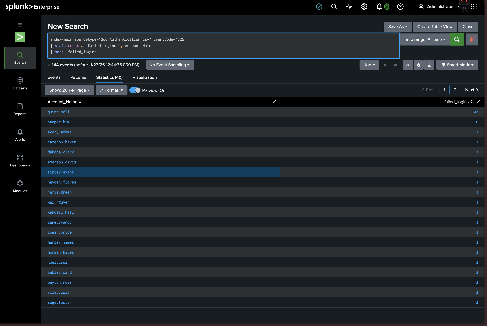
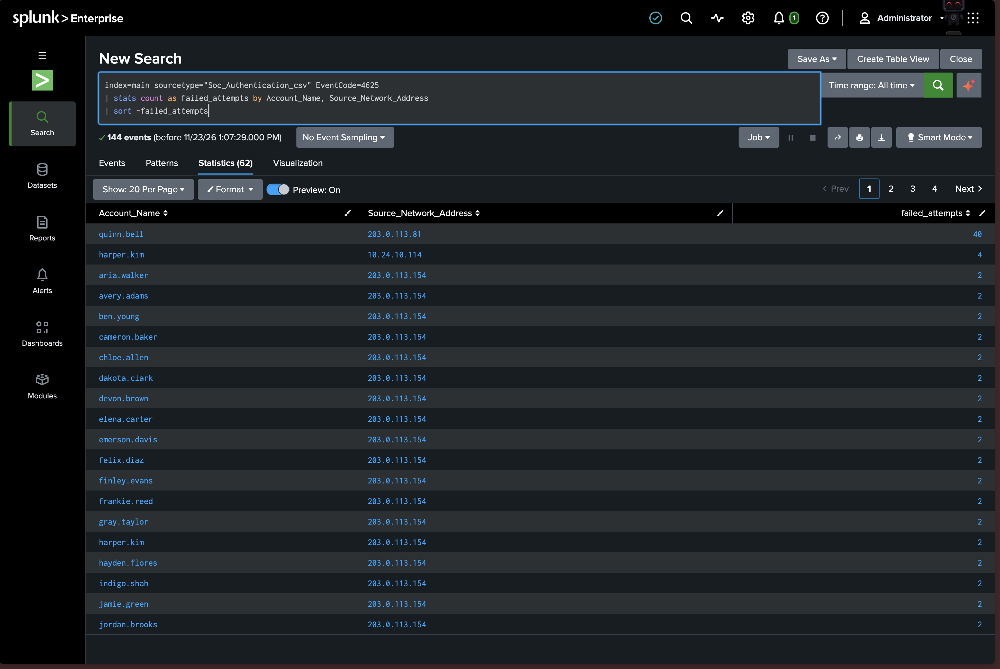
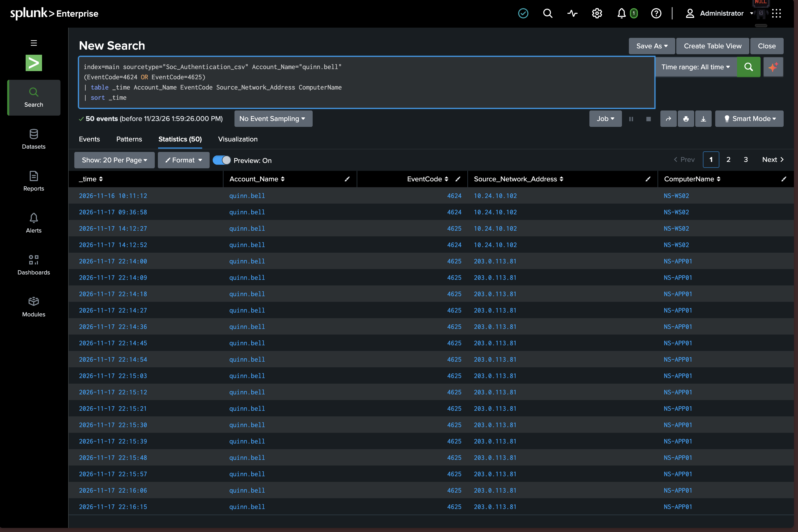
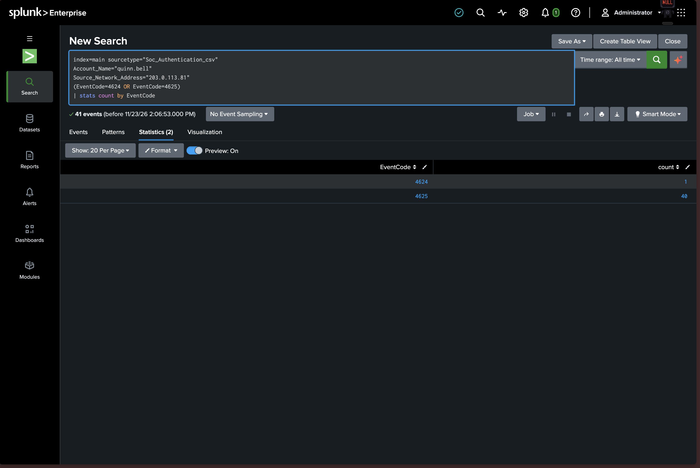
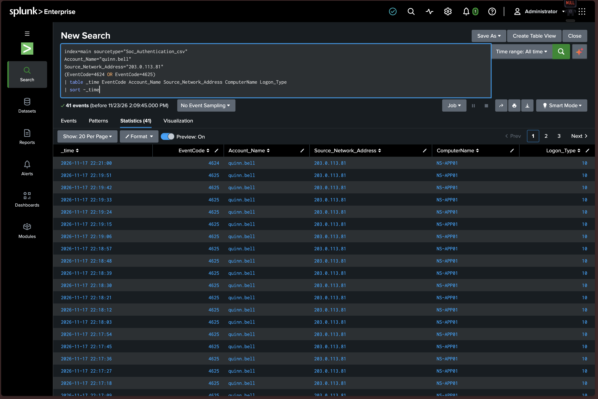
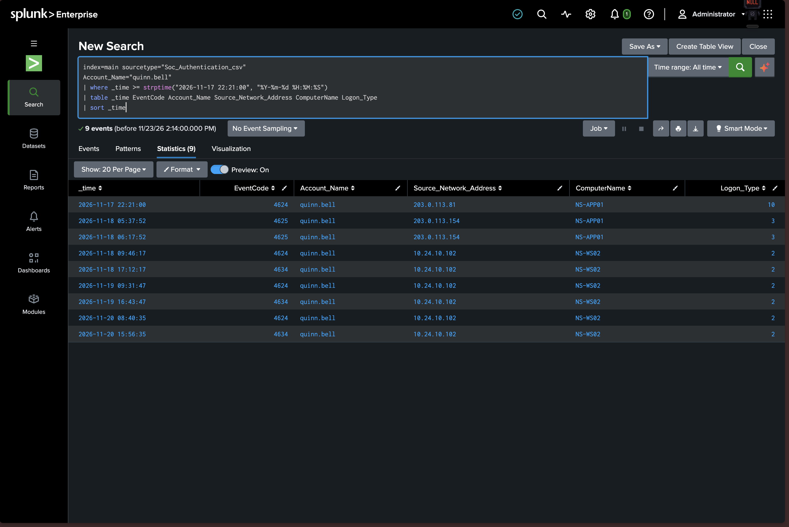

# INC-001: Suspected account compromise involving quinn.bell

> **Simulated SOC training investigation.** This report documents the analyst's manual Splunk investigation and interview responses. It is not production incident-response experience. Writing assistance was used to organize the analyst's reasoning and check it against project evidence. No instructor answer key was consulted for this report.

| Attribute | Assessment |
| --- | --- |
| Case ID | INC-001 |
| Incident date | November 17, 2026 |
| Classification | Suspected automated password guessing with subsequent successful remote interactive logon; suspected account compromise |
| Initial severity | High, provisional |
| Disposition | Unauthorized access remains unconfirmed; further investigation recommended |
| Account | `quinn.bell` |
| Source indicator | `203.0.113.81` — synthetic documentation address |
| Destination | `NS-APP01` |
| Incident time basis | Central Standard Time, UTC−06:00, verified against the original CSV |
| Investigation platform | Splunk Enterprise |
| Actual search selectors | `index=main sourcetype="Soc_Authentication_csv"` |
| Actions performed | Manual authentication searches, correlation, baseline comparison, and screenshot capture |
| Containment / remediation performed | None evidenced in the project |

## Executive summary

The analyst investigated `quinn.bell` after identifying 43 failed authentications across the reviewed dataset. Forty of these failures originated from `203.0.113.81` and targeted `NS-APP01` using Logon Type 10. The failures occurred at regular nine-second intervals between 22:14:00 and 22:19:51 on November 17, 2026. A successful authentication from the same source, account, destination and logon type occurred at 22:21:00, 69 seconds after the final failure.

The pattern is consistent with automated password guessing followed by possible unauthorized access. The analyst assigned provisional High severity because a remote interactive logon succeeded after the concentrated failure sequence. Authentication success is confirmed within the simulated records; malicious intent, successful password guessing as the cause, and account compromise are not confirmed.

No Event ID 4672 was observed in the investigated records. This does not establish that the account lacked privileges or that privilege-related activity could not have occurred. User validation, remote-access context and endpoint telemetry are needed to determine authorization, subsequent actions and business impact. Containment and remediation described below are recommendations only.

## Incident classification and severity

**Classification:** suspected credential attack and suspected account compromise. Regular failure spacing supports an automation hypothesis, but the records do not contain attempted passwords or identify the person or process responsible.

**Provisional severity: High.** The failure-to-success sequence involves remote interactive access to a server. Prompt investigation and proportionate containment are warranted. The severity is an analyst assessment, not evidence that a saved alert fired. Account entitlements, system criticality, data sensitivity and operational impact remain unknown. These uncertainties limit impact assessment; they do not establish critical impact.

The absence of an observed 4672 event does not justify treating the logon as harmless. Reassess severity as authorization, scope and business context become available, following the organization's severity matrix.

## Affected assets, identities and indicators

| Entity | Role in investigation | Evidence and limits |
| --- | --- | --- |
| `quinn.bell` | Identity used in the authentication sequence | Forty incident-scoped failures and one success; account ownership and entitlements were not independently validated |
| `NS-APP01` | Destination generating the scoped logon events | Successful remote interactive logon recorded; business criticality and host integrity remain unknown |
| `203.0.113.81` | Source associated with the suspected activity | Behavior-based indicator for this simulation, not a real-world malicious-IP determination |
| `NS-WS02` / `10.24.10.102` | Earlier internal authentication context | Useful baseline comparison, not an affected-host or compromise finding |

The source is in a reserved documentation network. Live geolocation or threat-intelligence reputation cannot validate this synthetic address. In a real environment, verify VPN/proxy/NAT attribution, approved remote access and asset ownership. An IP match does not uniquely identify an individual or endpoint.

## Investigation methodology

The analyst:

1. Aggregated Event ID 4625 by account to identify accounts with high failure counts.
2. Grouped failures by account and source to separate the 40 failures from the incident source from the account's 43 total failures.
3. Filtered 4624 and 4625 for the account and reviewed chronological activity.
4. Correlated account name, source IP, destination, logon type and timestamps to associate the failures with the later success.
5. Compared the sequence against earlier internal logons and reviewed subsequent account activity.
6. Reported no observed privileged-session event in the investigated records. The saved evidence does not include a dedicated 4672 search screenshot.

The displayed searches use All time against the fixed historical dataset. The project originally recommended `soc_lab` and `soc:windows:auth:csv`; those are **not** the selectors shown in the analyst's screenshots. Use the actual selectors above to reproduce this investigation.

During report preparation, a separate, narrowly scoped check of the unchanged CSV verified the supplied source/account/destination counts, timestamps, logon types and record identifiers. That check is supporting editorial verification, not a claim that the analyst ran a new Splunk search or automated the investigation. No hidden incidents were analyzed and the generator was not executed.

## Chronological event timeline

All event times below use November 17, 2026, CST (UTC−06:00), unless a different date is stated. Screenshot display timezone is not explicitly shown; the CSV offsets establish the time basis.

| Time | Observation | Evidence |
| --- | --- | --- |
| Before incident sequence | Earlier successful logons for the account originated from internal address `10.24.10.102` on `NS-WS02` | E03 |
| 22:14:00 | First of 40 scoped failures: Event ID 4625, source `203.0.113.81`, target `NS-APP01`, Logon Type 10 | E03; CSV record `1000309` |
| 22:14:00–22:19:51 | Forty failed attempts at nine-second intervals | E02, E04, E05; scoped CSV verification |
| 22:19:51 | Last scoped failure | E05; CSV record `1000348` |
| 22:21:00 | Event ID 4624 records successful remote interactive logon from the same source to the same target | E05; CSV record `1000349` |
| After 22:21:00 through the returned records dated November 20 | Account activity review shows later authentication/logoff records; it does not show process execution or establish what the remote session did | E06 |

**Timing correction:** the failures are nine seconds apart. The final failure-to-success gap is **69 seconds**, not nine seconds. The first failure-to-success elapsed time is seven minutes.

The subsequent-activity search is scoped to the account, not exclusively to the suspicious source or a session identifier. Later account events must not automatically be attributed to the remote session.

## Supporting Splunk queries

The queries below transcribe the searches visible in the saved evidence. Report preparation did not execute them against Splunk. Preserve the historical dataset and use the screenshot selectors rather than changing the original import.

### Q01: Failed authentications by account — E01

```spl
index=main sourcetype="Soc_Authentication_csv" EventCode=4625
| stats count as failed_logins by Account_Name
| sort -failed_logins
```

This establishes the account-level count, not the number attributable to a particular source or incident.

### Q02: Failures by account and source — E02

```spl
index=main sourcetype="Soc_Authentication_csv" EventCode=4625
| stats count as failed_attempts by Account_Name, Source_Network_Address
| sort -failed_attempts
```

The relevant result associates 40 failures with the account and source under investigation. Other rows represent separate leads, not conclusions in this case.

### Q03: Account authentication timeline — E03

```spl
index=main sourcetype="Soc_Authentication_csv" Account_Name="quinn.bell"
(EventCode=4624 OR EventCode=4625)
| table _time Account_Name EventCode Source_Network_Address ComputerName
| sort _time
```

### Q04: Incident-source authentication counts — E04

```spl
index=main sourcetype="Soc_Authentication_csv"
Account_Name="quinn.bell"
Source_Network_Address="203.0.113.81"
(EventCode=4624 OR EventCode=4625)
| stats count by EventCode
```

The screenshot shows 40 failures and one success in the selected scope. Counts alone do not establish sequencing.

### Q05: Scoped sequence and logon type — E05

```spl
index=main sourcetype="Soc_Authentication_csv"
Account_Name="quinn.bell"
Source_Network_Address="203.0.113.81"
(EventCode=4624 OR EventCode=4625)
| table _time EventCode Account_Name Source_Network_Address ComputerName Logon_Type
| sort -_time
```

Descending ordering places the success above the preceding failures. Logon Type 10 indicates RemoteInteractive, commonly associated with RDP; it does not establish authorization.

### Q06: Account activity after the successful logon — E06

```spl
index=main sourcetype="Soc_Authentication_csv"
Account_Name="quinn.bell"
| where _time >= strptime("2026-11-17 22:21:00", "%Y-%m-%d %H:%M:%S")
| table _time EventCode Account_Name Source_Network_Address ComputerName Logon_Type
| sort _time
```

This is the captured query. Its timezone-free `strptime` literal depends on the search environment's timezone. For a future reproducibility capture, use an explicitly offset-bearing boundary and confirm timezone settings; that revised search has not been executed here.

## Evidence register and screenshots

| ID | Saved evidence | What it supports |
| --- | --- | --- |
| E01 | `01_failed_logins_by_account.png` | Initial account-level failure ranking and 43 total failures |
| E02 | `02_failed_logins_by_account_and_source.png` | Account/source breakdown and 40 scoped failures |
| E03 | `03_account_authentication_timeline.png` | Earlier internal behavior and beginning of the failure sequence |
| E04 | `04_authentication_outcome_counts.png` | Forty failures and one success for the selected account/source |
| E05 | `05_authentication_timeline_with_logon_type.png` | Last failure, success, destination and Logon Type 10 |
| E06 | `06_post_authentication_account_activity.png` | Subsequent account-scoped authentication records |

Screenshots are partial UI captures, not complete raw-event exports or proof of all subsequent host activity. Record IDs below were verified in the CSV during report preparation; they are not visible in these screenshot tables. The lab uses globally unique EventRecordIDs; real Windows record IDs require host/log scope and are not session identifiers.

### E01 — Initial failure analysis



### E02 — Account and source correlation



### E03 — Account authentication timeline



### E04 — Authentication outcome counts



### E05 — Remote interactive sequence



### E06 — Subsequent account activity



## Findings and confidence assessment

| Statement | Assessment | Confidence / limitation |
| --- | --- | --- |
| Forty failures followed by one successful logon share account, source, target and Logon Type 10 | Confirmed within the simulated records | High; supported by screenshots and scoped CSV verification |
| Failure spacing is consistent with automated retries | Supported inference | High confidence in the regular timing; client/process responsible is unknown |
| The activity represents automated password guessing | Reasonable suspicion | Moderate; misconfigured software or authorized testing has not been excluded |
| The successful logon was unauthorized | Unconfirmed | Requires trusted user validation and corroborating connection/session evidence |
| The account was compromised through successful password guessing | Unconfirmed | The logs do not show attempted passwords or prove causation |
| No privileged-session event was observed | Limited negative finding | Analyst-reported in reviewed records; scoped CSV check also found no 4672, but this is not assurance of complete auditing |
| Persistence, lateral movement or data exfiltration occurred | Not established | Necessary endpoint/network evidence is absent |

Overall assessment: **suspected account compromise, with moderate confidence in unauthorized-access interpretation and high confidence in the observed authentication sequence**. Confidence labels are qualitative, not measured probabilities.

The dataset lacks session identifiers, process telemetry, trusted source inventories and independent user validation. Matching a shared source IP does not prove a single actor. Failure codes can help explain rejection reasons but do not alone exclude client misconfiguration. Absence of telemetry cannot establish absence of malicious activity.

## Alternative explanations and further evidence needed

Potential benign explanations include repeated incorrect password entry, stale or expired credentials followed by a verified update, a misconfigured application/client, or approved security testing. These are hypotheses, not explanations confirmed for this case.

Recommended checks:

- Contact the account owner using a trusted channel and corroborate their response against independent records.
- Validate approved remote-access infrastructure, VPN/proxy/NAT attribution and relevant change or test authorizations. Live reputation checks do not apply to the synthetic source address.
- Review failure status/substatus values and password-reset history alongside client/process context.
- Obtain Windows Security, RDP session and EDR telemetry from `NS-APP01`, checking collection coverage and retention first.
- Review processes, privilege/account changes, persistence, outbound connections, lateral movement and potential data access. Unusual traffic alone does not establish exfiltration.
- Correlate account, host, timestamp and, where available, host-scoped Logon ID and other session/process identifiers. This lab cannot perform those richer joins.
- Establish account entitlements, asset ownership, business criticality and potentially exposed data before assigning final impact.

## Recommended containment — not performed

Follow response authority and the organization's playbook. Collect relevant evidence and contain in parallel where possible, without unnecessarily delaying urgent protection.

1. Temporarily disable or restrict the suspected identity as authorized, assessing dependencies and business impact.
2. Identify and terminate relevant active remote sessions; verify termination separately because disabling an account or resetting a password may not end existing access.
3. Initiate a secure credential reset and address applicable sessions/tokens for the affected authentication systems.
4. Consider a scoped source block after validating legitimate infrastructure attribution. Treat blocking as supplementary, not a substitute for identity/session containment.
5. Coordinate with the `NS-APP01` owner. Recommend full host isolation only when evidence or risk justifies the disruption.
6. Record decision owners, approvals, timestamps, rationale, outcomes and rollback considerations for any real actions.

No such actions are evidenced in the project, and no real systems or accounts were modified.

## Recommended eradication and recovery — not performed

Investigate root cause and scope; inspect for persistence, lateral movement and unauthorized changes. Address identified weaknesses, reset credentials securely, review permissions and verify that MFA protects the actual remote-access path. Review and terminate remaining sessions as appropriate.

Before restoring access, validate relevant system integrity and remediation findings, document unresolved uncertainty, and obtain incident-response approval. Assign an owner and observation period for heightened monitoring. Recovery should use explicit verification criteria rather than assume a password reset resolved the incident.

Root cause may remain uncertain. Document residual risk and the basis for recovery decisions. No remediation, restoration or recovery testing is claimed as completed.

## Detection improvements

The analyst proposed correlating 4625 failures with a later 4624 success using identity, source, destination, logon type and event time, then enriching candidates with entitlements, asset criticality and endpoint context.

**Proposed test conditions:** at least ten failures within a rolling five-minute observation window, followed by a success within five minutes of the final failure. These are two separate timing conditions, not an undifferentiated ten-minute count. Require the failures to precede the success. The rule should not hardcode this case's account or source.

These settings are a hypothesis to test, **not an implemented or validated revision**. Existing project detection files use their own documented settings; this report does not change them. The saved password-spraying alert configuration concerns a different detection and does not demonstrate execution or triggering of this proposed failure-to-success rule.

Recommended validation and tuning:

- Compare results against normal behavior and approved automation; do not tune solely to this one incident.
- Test rolling boundaries, equal timestamps, intervening successes, different correlation keys, late ingestion and duplicate suppression.
- Evaluate slower guessing and distributed sources as separate coverage gaps; raising thresholds can reduce noise while missing attacks.
- Use narrow, verified exceptions with an owner, rationale and review/expiry date. Avoid blanket account/IP exemptions.
- Monitor false positives and analyst workload alongside known missed cases. No production efficacy metrics have been measured.

## Lessons learned and analyst contribution

The analyst described improved understanding of authentication analysis, event correlation and detection engineering in Splunk. The central lesson was distinguishing evidence suggestive of malicious activity from evidence confirming unauthorized access.

The analyst's demonstrated work includes running authentication searches, identifying the source-specific failure pattern, comparing earlier behavior, reviewing the successful logon and subsequent account records, and capturing supporting screenshots. Generated project scaffolding and writing assistance should be disclosed when discussing authorship.

For future investigations, the analyst would establish behavioral baselines earlier, incorporate additional telemetry and evaluate rolling-window failure-to-success detection. Python automation is a proposed learning direction for repetitive investigation work, with human oversight retained. The project contains Python tools, but their existence does not establish that the analyst used or independently implemented them for this case.

## Outstanding documentation and capture tasks

- Capture the actual privileged-event search, with visible query, result count and investigation time range. Suggested filename: `11_quinn_bell_privileged_event_review.png`. A zero-result search documents its scope, not complete absence of privilege-related activity.
- Capture a reproducible scoped timeline including `timestamp`, `EventRecordID`, account, source, destination, event code and logon type. Include the original UTC offset and both the final failure and success. Suggested filename: `12_quinn_bell_timeline_with_record_ids.png`.
- Export the scoped raw records if desired, recording acquisition details and a file hash. No such Splunk export is currently evidenced.
- Obtain external corroboration only in an authorized environment. Until then, keep authorization, root cause and post-logon impact unresolved.

Existing screenshot filenames are unchanged. The six referenced screenshots are included in version control, together with four other reviewed project captures, through explicit `.gitignore` exceptions. See [publication notes](README.md) before adding further evidence.
